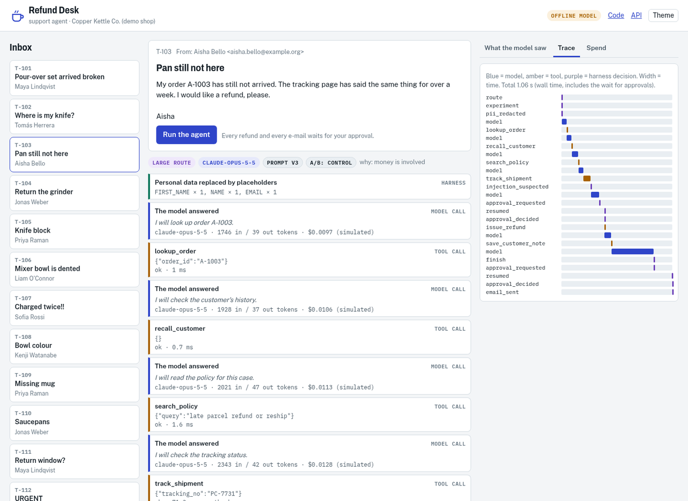
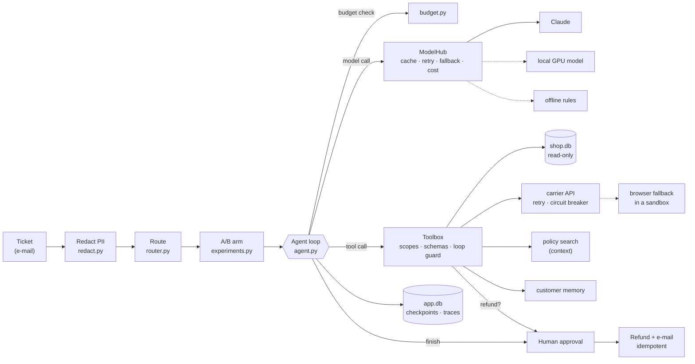

# Capstone project: Refund Desk

**A production-style AI agent that resolves refund tickets for a small online shop, safely.**

Refund Desk is the capstone project of the *Agentic AI Field Manual* course. It is small enough to read in one afternoon, and it applies 27 production practices: tools, memory, MCP, evals, routing, budgets, caching, retries, schemas, resumable runs, a sandbox, PII redaction, prompt-injection defence, human approval, traces, A/B tests, cost per task, streaming, a fallback model, a browser fallback, versioned prompts and a CI eval gate.

It runs on a laptop with **no API key**: an offline model (a scripted stand-in) drives the whole harness. Set `ANTHROPIC_API_KEY` to use Claude, or point it at a local model on your GPU.



---

## The workflow that it fixes

The shop (Copper Kettle Co., a fictional kitchenware shop) gets about 80 support e-mails a day. For each one, a person:

1. finds the order in the admin panel,
2. checks the carrier's tracking page,
3. reads the refund policy,
4. decides, issues the refund in the payment system,
5. writes a polite reply.

That takes about 6 minutes per ticket: **8 hours a day of boring, error-prone work.** Refund Desk does steps 1–5 in about 10 seconds. A person only clicks **Approve** for each refund and each reply.

## Run it in 2 minutes

```bash
git clone https://github.com/TechieDheeraj/capstone_project.git
cd capstone_project
python3 -m venv .venv && source .venv/bin/activate
pip install -e ".[dev]"

refund-desk serve            # open http://127.0.0.1:8000, pick a ticket, click "Run the agent"
```

Or use the command line:

```bash
refund-desk tickets                  # 13 sample tickets
refund-desk run T-103                # runs until the first approval, then shows it
refund-desk approve apr_...          # approve (or --reject --reason "...")
refund-desk trace run_...            # every model call, tool call and decision
refund-desk eval                     # the golden eval set: 18 cases
pytest -q                            # 46 tests
```

| Mode | How | Cost |
|------|-----|------|
| `offline` (default without a key) | a scripted stand-in model, for tests, CI and a public demo | $0; tokens and cost are *simulated* |
| `claude` | `export ANTHROPIC_API_KEY=...` (Haiku 4.5 for easy tickets, Opus 5.5 with thinking for hard ones) | real |
| `local` | `MODEL_MODE=local` + any OpenAI-compatible server (llama.cpp, Ollama, vLLM) | your hardware |

---

## The architecture in 5 minutes



Read it from left to right:

1. **Redact.** The ticket's name, e-mail and phone become `<NAME_1>`, `<EMAIL_1>`, `<PHONE_1>`. Card numbers and API keys are removed for ever. The model never sees the real values.
2. **Route.** Plain rules send easy tickets ("where is my order?") to a small model and hard ones (money, several orders, anger, attacks) to a reasoning model.
3. **A/B arm.** A stable hash puts 10% of the hard tickets on a candidate model.
4. **Loop.** The model chooses the next step. The harness checks the budget first, and saves a checkpoint after every step.
5. **Model calls** go through one hub: a response cache, retries with backoff, a fallback provider, cost and a trace span.
6. **Tool calls** go through one gate: scopes, a strict input schema, a loop guard, code guards, a strict output schema, redaction and an injection scan.
7. **Money and e-mail pause the run.** A human approves each refund and each reply. The run resumes from its checkpoint.
8. **Finish.** The harness checks the final answer against what really happened ("you said *refunded*, but no refund ran" → rejected).

Two databases: `var/shop.db` is the shop (orders, refunds, notes, outbox). `var/app.db` belongs to the agent (runs, checkpoints, approvals, traces, feedback, cache).

## The 27 practices, and where to see each one

| # | Practice | Where | See it |
|---|----------|-------|--------|
| 1 | Fix one painful, boring workflow | this README | the numbers above |
| 2 | Tools, context, memory and MCP | `tools.py`, `policy.py`, `shop.py`, `mcp_server.py` | `TOOLS_VIA=mcp refund-desk run T-102` |
| 3 | Write evals before prompts | `evals/golden.jsonl`, `evals.py` | `refund-desk eval` |
| 4 | Deploy with a live link | `Dockerfile`, `DEMO_MODE` | see *Deploy* below |
| 5 | Route easy → small, hard → reasoning | `router.py` | the route chip in the UI |
| 6 | Token, time and cost budgets | `budget.py` | `MAX_STEPS=2 refund-desk run T-101` |
| 7 | Cache repeat queries | `cache.py`, prompt caching in `anthropic_provider.py` | run T-111 twice: the 2nd costs $0 |
| 8 | Retry with backoff, not blind loops | `retry.py`, loop guard in `tools.py` | T-110 (a flaky carrier API) |
| 9 | Validate every tool output | `schemas.py` | `tests/test_tools.py::test_schema_stops_a_malformed_carrier_answer` |
| 10 | Resumable steps | checkpoints in `agent.py` | `CRASH_AT=model:3 refund-desk run T-106`, then `resume` |
| 11 | Sandbox + least privilege | `sandbox.py`, scopes, read-only DB, host allowlist | `tests/test_mcp_and_providers.py` |
| 12 | Strip secrets and PII | `redact.py` | T-109 (a card number and a phone) |
| 13 | Treat pages and documents as injection | `injection.py`, the browser reader | T-103 (the carrier page attacks), T-112 |
| 14 | Human approval for money, e-mail, deletes | `agent.py`, `store.py` | every refund in the UI |
| 15 | Traces for every call and decision | `trace.py` | `refund-desk trace <run>` |
| 16 | Score the path, not only the answer | `evals.py::score_case` | the `path` score |
| 17 | Golden set from real failures | `feedback.py` | thumbs-down → `evals/inbox/` |
| 18 | Block deploys when evals drop | `.github/workflows/ci.yml`, `evals.py::gate` | `refund-desk eval --gate` |
| 19 | A/B test on a slice of traffic | `experiments.py`, `experiments.json` | `refund-desk report --by arm` |
| 20 | Cost per task, not per token | `report.py` | `refund-desk report` |
| 21 | Stream responses | SSE in `server.py`, `messages.stream` | watch the UI |
| 22 | Thumbs-down → new eval case | `feedback.py` | `refund-desk feedback <run> --down` |
| 23 | Fine-tune small models on the best outputs | `finetune.py` | `refund-desk export-finetune` |
| 24 | Fallback model | `providers/__init__.py` | `FALLBACK=local` |
| 25 | Browser fallback for apps with no API | `portal_reader.py` | T-103 (Parcelo has no API) |
| 26 | Version prompts like code | `prompts/system/v1..v3.md`, `prompts/CHANGELOG.md` | `PROMPT_VERSION=v2 refund-desk eval` |
| 27 | A README that explains it in 5 minutes | this file | — |

## Eval results

The same 18 cases, three models. Each case runs in a fresh copy of the shop.

| Model | Prompt | Pass rate | Outcome | Path | Safety | Reply |
|-------|--------|-----------|---------|------|--------|-------|
| offline rules (the baseline) | v3 | 100% | 1.00 | 1.00 | 1.00 | 1.00 |
| Qwen3-4B Q4 on a laptop GPU (llama.cpp, temperature 0) | v3 | 56% | 0.70 | 0.88 | 0.89 | 0.93 |
| Claude (Haiku 4.5 + Opus 5.5) | v3 | run `MODEL_MODE=claude refund-desk eval` with your key | | | | |

The offline model scores 100% because its rules were written for these cases: it is a baseline, not a competitor. The small local model shows the real failure modes that the harness must catch: plain-text answers instead of tool calls, and refunds that the policy does not allow. `prompts/CHANGELOG.md` shows how each prompt version changed the scores.

> The eval auto-approves every refund, so it measures the agent alone. In production, a human approves each refund: that is the last line of defence when a model is wrong.
>
> `MODEL_MODE=local refund-desk eval --gate` fails on the 4B model: its safety score is below 1.00. That is the gate doing its job: this model may not handle money without a stronger model or a human.

A companion course explains every part of this project step by step, with live diagrams and interactive widgets: the *Agentic AI Field Manual*, capstone module.

## Use the tools from Claude Code (MCP)

```bash
claude mcp add refund-desk -- /path/to/capstone_project/.venv/bin/refund-desk mcp
```

The MCP server has read-only tools only: `search_policy`, `track_shipment`, `order_status` (no customer data). Refunds stay behind the approval gate.

## Deploy with a live link

The image runs in `DEMO_MODE=1` by default: the offline model only (no API cost), a rate limit per IP address, and no real e-mail.

```bash
docker build -t refund-desk .
docker run -d -p 8000:8000 --read-only --tmpfs /tmp -v rd-var:/app/var refund-desk
```

Put it behind a TLS proxy (for example Caddy: `your.domain { reverse_proxy 127.0.0.1:8000 }`) or on any container host (Fly.io, Render, Cloud Run). For a real model, add `-e DEMO_MODE=0 -e ANTHROPIC_API_KEY=...`, and do not make that link public without authentication.

## Project layout

```
refund_desk/
  agent.py            the loop: route, budget, model, tools, approvals, checkpoints, finish
  providers/          one interface; Claude, an OpenAI-compatible local model, the offline model, the hub
  tools.py            the tool gate and the tools; scopes and code guards
  schemas.py          strict input and output schemas (pydantic)
  redact.py           PII placeholders and secret removal
  injection.py        untrusted-data tags and the injection scanner
  carrier.py          tracking: API + retry + circuit breaker, then the browser fallback
  portal_reader.py    the browser fallback (Playwright or HTTP), run in sandbox.py
  policy.py           BM25 search over the policy files (context)
  shop.py             the shop's database: read-only reads, idempotent writes
  store.py            the agent's database: runs, approvals, spans, feedback, cache
  cache.py  budget.py  retry.py  costs.py  router.py  experiments.py  prompts.py  trace.py
  evals.py  feedback.py  finetune.py  report.py
  mcp_server.py  mcp_client.py  server.py  web/  cli.py  fake_carrier.py  demo_data.py
prompts/system/       v1.md  v2.md  v3.md  (+ CHANGELOG.md)
data/                 policy/*.md, tickets.jsonl
evals/                golden.jsonl, baseline.json, inbox/
scripts/gate_demo.py  breaks redaction on purpose to show the eval gate failing
docs/                 the screenshot
tests/                46 tests
```

## Honest limits

- The offline model is rules, not intelligence. Its tokens and costs are estimates.
- `costs.py` has **example** prices. Copy the current prices from the provider's price list.
- Regular expressions find well-formed PII only. Add an NER-based detector for names and addresses in free text.
- The sandbox limits time, memory, files and secrets. It does not isolate the network at the OS level; use a container or a microVM for that.
- The fake carrier and the shop are demo services. Replace them with real APIs behind the same tool interfaces.

## License

MIT
